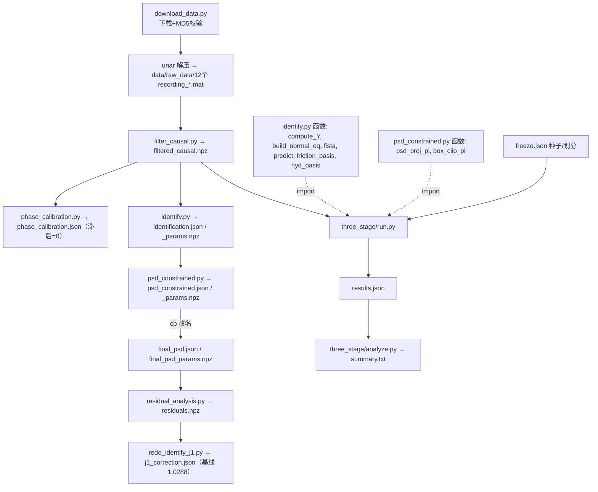
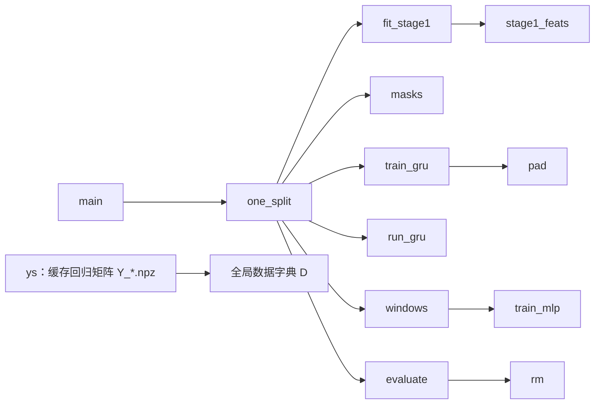

# 代码详细说明（CODE_GUIDE）

本文只描述代码**实际实现**的内容。三阶段代码在 `three_stage/`，它复用仓库根目录的 `identify.py`、`psd_constrained.py`（通过 `sys.path` 导入），并读取根目录的 `filtered_causal.npz`。

## 0. 总体调用关系



run.py 内部调用：


## 1. 原仓库脚本（基线用到的部分，简述）

| 文件 | 作用 | 输入 → 输出 |
|---|---|---|
| `download_data.py` | 从 DOI 文件库下载两个 rar，并按大小+MD5 校验；不解压 | 网络 → `data/*.rar` |
| `filter_causal.py` | 12 段录制，前 11 段训练、第 12 段测试；每段按回零停留中点切成 6 条轨迹；4 阶因果 Butterworth 2 Hz（sosfilt+稳态初值）；加速度为 250 Hz 后向差分；每 25 点降采样到 10 Hz；力矩为电机侧 Nm | `data/raw_data/*.mat` → `filtered_causal.npz`（`{train,test}_{q,qd,qdd,tau,seg_id}`） |
| `phase_calibration.py` | 0–20 ms 滞后的按轨迹交叉验证；曲线平坦，取滞后 0 | → `phase_calibration.json` |
| `kr300_model.py` | 文献 DH 参数建 pinocchio 模型，给 6×60 回归矩阵 | 被 identify 导入 |
| `identify.py` | 模型 τ_j = r_j·Y_j(q,q̇,q̈)π + f_j(q̇_j) + hyd_j(q2)；摩擦基 f = f0+fv·q̇+fc·tanh(20q̇)+fa·tanh(2q̇)；液压平衡（仅 J2）基 sin/cos(q2), sin/cos(2q2)；交替：给定 r 用有界 FISTA 解 (π,摩擦,液压)，再按关节标量 LS 更新 r（r1=1，裁剪 [0.2,5]） | → `identification.json/_params.npz` |
| `psd_constrained.py` | 固定 r，在“逐连杆空间惯量 PSD 投影 + 盒约束”下用投影 FISTA 最小化力矩误差，再固定 π 重拟合摩擦/液压 | → `psd_constrained.json/_params.npz` |
| `residual_analysis.py` | 读 `final_psd_params.npz`，计算残差及相关性 | → `residuals.npz`, `residual_analysis.json` |
| `redo_identify_j1.py` | J1 事后修正：冻结 PSD 模型，对 J1 残差关于 q̈1 做标量 LS 得 d；输出 posthoc 测试指标（基线 94 参数，traj12 macro 1.0288） | 需 `final_psd_params.npz`、`residuals.npz` → `j1_correction.json` |

**运行顺序的坑（reproduce.sh 已处理）**：原 README 把 `redo_identify_j1` 放在 `residual_analysis` 之前，但前者读取后者生成的 `residuals.npz`；且没有任何脚本生成 `final_psd_params.npz`，交付的物理模型就是 `psd_constrained` 的输出，所以复制改名为 `final_psd*`。

## 2. `three_stage/run.py`（主实验，约 180 行）

### 2.1 数据与缓存
- `REPO`：默认取脚本所在目录上两级（即仓库根），可用环境变量 `KR300_REPO` 覆盖。**这是相对已推送版本唯一的改动**（原来硬编码 `/workspace/kr300-identification`），不影响计算。
- `ys(split)`：对 `train/test` 计算三组回归矩阵并缓存到 `three_stage/Y_{split}.npz`（约 330 MB + 30 MB，不入库）：
  - `Yf = Y(q, q̇, q̈)`（完整），`Yc = Y(q, q̇, 0)`（科氏+重力），`Yg = Y(q, 0, 0)`（重力）。
- 全局 `D[split]` 存 q, q̇, q̈, τ（6×N）、`seg`（轨迹编号）与上述 Y（N×6×60）。

### 2.2 阶段 1：`fit_stage1(idx)` —— 物理模型（只用训练索引 idx）
完整复刻仓库交付的物理流程：
1. **交替有界最小二乘**（同 identify.py）：最多 10 次；每次 `build_normal_eq` + `fista(iters=1500)` 得 θ=[π(60), 摩擦(6×4), 液压(4)]，再对 j=2..6 标量更新
   r_j = clip( (Y_jπ)ᵀ(τ_j − f_j − hyd_j) / ‖Y_jπ‖², 0.2, 5 )；θ 变化 <1e-4 停止。
2. **PSD 约束重拟合**（同 psd_constrained.py）：A=Σ_j (r_jY_j)ᵀ(r_jY_j)，b=Σ_j (r_jY_j)ᵀ(τ_j−f_j−hyd_j)，步长 1/λ_max(A)，800 次投影 FISTA，投影 = `box_clip_pi(psd_proj_pi(·))`。
3. **摩擦/液压有界重拟合**：π 固定，28 维（6×4 摩擦 + 4 液压，J2 摩擦与液压耦合）正规方程，盒约束 lo=[−10,0,0,−20]×6+[−40]×4，hi=[10,20,20,20]×6+[40]×4，1000 次 FISTA。
4. **J1 事后惯量项**：d = clip( q̈1ᵀ(τ1 − p1) / q̈1ᵀq̈1, −100, 100 )。
返回 (r, θ, d)，共 60+28+5(r)+1 = 94 个参数。CV 时每折只用折内训练轨迹重拟合；测试时用全部 11 段，复现基线 1.0288。

### 2.3 `stage1_feats` —— τ1 与可解释特征 φ
对每个关节 j（5 个分量，φ ∈ R^{6×5}）：
- φ_j,0 惯性 = r_j (Yf−Yc)_j π（+ d·q̈1，仅 J1）
- φ_j,1 科氏/离心 = r_j (Yc−Yg)_j π
- φ_j,2 重力 = r_j Yg_j π
- φ_j,3 摩擦 = f_j(q̇_j)
- φ_j,4 液压 = hyd(q2)（仅 J2，其余为 0）

τ1 = Σ_k φ_j,k。网络输入 z = [q(6), q̇(6), q̈(6), τ1(6), φ(30)] = 54 维，用**折内训练集**均值/标准差标准化（`ns`）。**任何阶段都不输入实测扭矩历史**，τ 只作为训练目标（纯逆动力学）。

### 2.4 `masks` —— 慢速/停留掩码
- 候选：max_j |q̇_j| < 0.05 rad/s。
- 同一轨迹内连续候选长度 ≥10（1 s）记为 slow；≥30（3 s）记为 dwell；其余为 motion。
- 实际数据中 dwell 与 slow 完全相同（所有慢速段都 ≥3 s），结果里两行一致。

### 2.5 阶段 2：F_mot（`train_gru` / `run_gru`，PyTorch）
- 结构 `GRUM`：1 层 GRU（隐层 32）+ 线性头 6；输出 r2 与隐状态序列 h2（32 维）。
- 目标：(τ − τ1)/ysd，ysd 为折内训练集 τ−τ1 的逐关节标准差。
- 损失：**只在运动样本上**计算的掩码 MSE：L = Σ_t m_mot(t)·mean_j(r̂2−y)² / Σ_t m_mot(t)。
- 训练：整条轨迹为序列、全部轨迹 padding 成一个 batch，Adam lr=1e-3，300 epoch，无早停，梯度裁剪 1.0，`torch.manual_seed(seed)`。
- 推理：沿**整条轨迹**（含慢速段）逐条运行，τ2 = τ1 + r2·ysd，h2 为隐状态；训练后冻结，不再更新。

### 2.6 阶段 3：F_slow（两个版本，各用于 G2 与 G4）
输入/目标：
- G2：输入 ns(z)，目标 (τ−τ1)/ysd，基底 τ1。
- G4：输入 [ns(z), (τ2−μ)/σ, h2]（54+6+32=92 维；μ,σ 取训练集 τ2 统计），目标 (τ−τ2)/ysd，基底 τ2。

**GRU 版**（`-GRU`）：同 2.5 的结构与训练设置，但损失只在 slow 样本上；推理后输出 τ = base + m_slow·r3·ysd。

**滑动窗口版**（`-Win`）：`windows` 把每个时刻的过去 W=30 步（含当前）输入展平（轨迹开头用首样本重复填充），只取 slow 样本训练 numpy MLP（`train_mlp`：1 隐层 64 tanh，线性输出 6，权重 N(0,1/fan_in)，Adam lr=1e-3，全批 1000 epoch，`default_rng(seed)`）；输出只写在 slow 样本上，其余为 0。

最终输出（与 freeze.json 一致）：
- G1 = τ1；G3 = τ2；G2 = τ1 + m_slow·r3；**G4 = τ2 + m_slow·r3**。

注意：G4 的阶段 3 训练用的 τ2、h2 是阶段 2 在**其自身训练数据**上的输出（样本内），未做交叉拟合。

### 2.7 评价 `evaluate` / `rm`
逐关节 RMSE（Nm），macro = 6 关节平均；分层 overall / motion（非 slow）/ slow / dwell。

### 2.8 `__main__`
- `rec = seg // 6` 为录制编号（0–10）。五折按录制分组：{0,1,2}, {3,4}, {5,6}, {7,8}, {9,10}。
- 每折、每个种子（0,1,2）跑 `one_split`；阶段 1 参数在同一折的三个种子间复用（与种子无关）。
- 最后用全部 11 段训练、在第 12 段（test）上评估（仅描述性）。
- 写 `results.json`（含 freeze.json 的 sha256）。8 线程 CPU 约 77 分钟。

## 3. `three_stage/analyze.py`
读 `results.json`，生成 `summary.txt`：
- CV：每折先对 3 个种子取平均，再对 5 折平均；方括号为“各种子的 5 折均值”的 [min,max]；同时给逐折值和关节平均。
- 配对比较：每折 d_f = mean_seed(G4 − G2)，分别对 GRU/Win、overall/slow/dwell；预注册判据（仅 overall）：5 折全部 d_f<0 且均值<0 → 打印 `USEFUL`。
- 测试集 traj12：各组 3 个种子的均值 [min,max] 与关节值。

## 4. `three_stage/freeze.json` / `freeze.sha256`
预注册配置（数据、划分、各阶段结构与训练设置、种子、判据），在任何阶段 2/3 结果出来之前写定；sha256 = `fba00a67…ece8ed`（freeze.json 未改动）。`freeze.sha256` 第二行是**原始** run.py 的哈希；现 run.py 仅改了 `REPO` 路径一行，所以该行不再匹配，reproduce.sh 只校验 freeze.json 行。原版与现版差异：
```
- REPO = '/workspace/kr300-identification'; sys.path.insert(0, REPO)
+ REPO = os.environ.get('KR300_REPO', <脚本上两级目录>); sys.path.insert(0, REPO)
```
analyze.py 也只加了一行 `os.chdir(脚本目录)`，使其可从任意目录运行。
